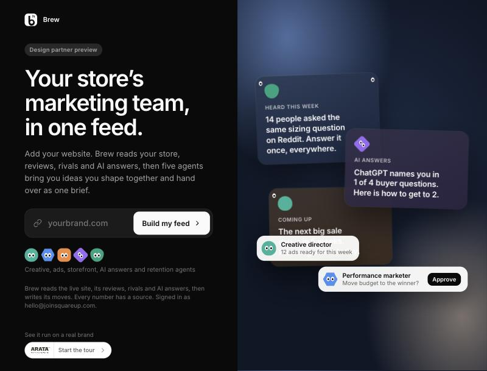
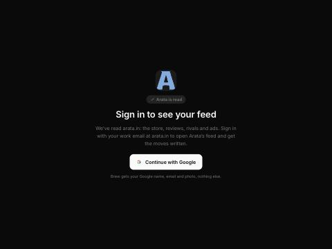
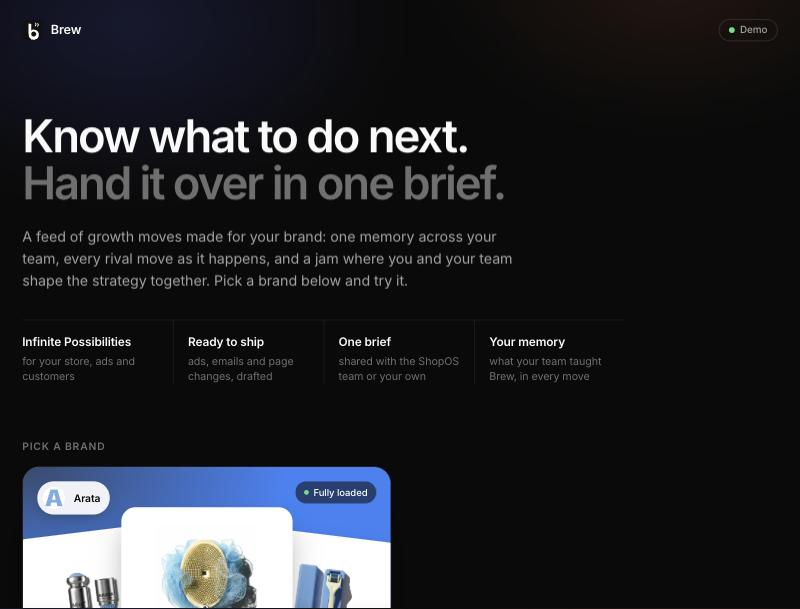
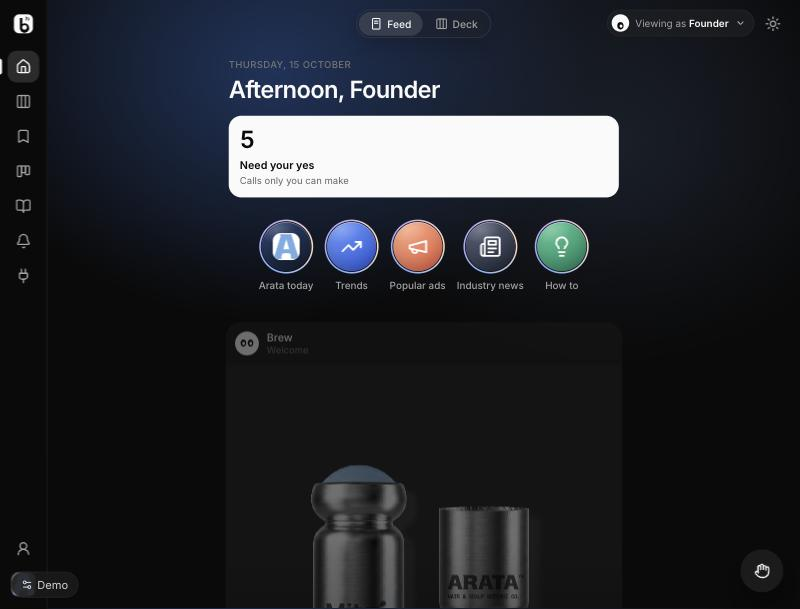
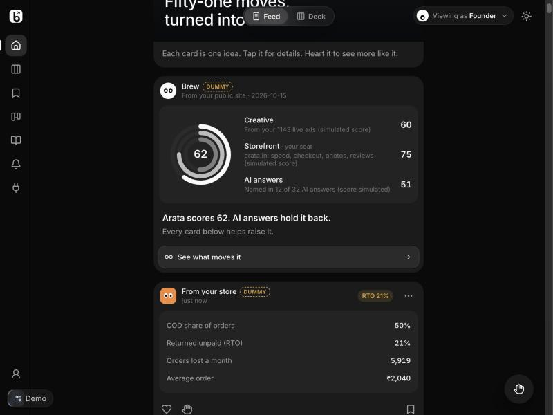

# 02 · User journeys

*Screenshots are from the live sites on 2026-10-15.*

## Journey A: a brand tries Brew on its own site (brew.joinsquareup.com)

1. **Landing.** The brand types its domain and taps **Build my feed**. No sign-in is needed to start the read.

   

   *Watch for:* the hero card "Performance marketer · Move budget to the winner? **Approve**" suggests Brew moves budget. It doesn't (Do it now was cut).

2. **"Reading {Brand}".** Brew opens the store and reads the brand, catalog, reviews, ads, site and AI answers. Each step shows a real finding as it lands. About 3–4 minutes, and about $6 for us.
   - If the store blocks us, the screen can hang.
   - A step that found nothing still gets a green tick.

3. **Sign in to see your feed.** The read is done. To open the feed and get the moves written, the person signs in with Google, using a work email at the brand's domain.

   

4. **Check what we read.** They fix the name, products, hero products and rivals, and add their Meta ad page, Instagram and review page. They tap **Looks right, write my moves**. This **claims the brand** for them.

5. **Pick your view.** Founder, ads, storefront, retention and so on.

6. **The moves are written in the background,** over several hours for the full set. The first 10 arrive first, and Brew **emails** "your first moves are ready" and later "all your moves are ready". Cards appear in the feed as moves finish. The full build costs us about $100–150.

7. **The feed.** See Journey C.

8. **Invite the team.** The owner invites colleagues by email (Brew sends the invite) and picks their views. Colleagues at the same domain join automatically, and the owner gets an email.

## Journey B: a prospect in a sales call (demo.joinsquareup.com)

1. **Pick a brand** (Arata) → **Start the tour** or **Jump to the feed**.

   

2. **The tour** replays the read live, shows "Check what we read", then lands in the feed. About 4 minutes.
3. **Connect accounts** (simulated) from the Tools step or the plug icon. Shopify, Meta and the others fill in the simulated numbers, and the "Dummy" cards appear.
4. Continue with Journey C. Each visitor's changes stay in their own sandbox.

## Journey C: living in the feed

- **Top of the feed:**
  - a greeting for the chosen view;
  - "Need your yes": calls only this person can make;
  - **story rings**: Arata today, Trends, Popular ads, Industry news, How to.
- **The cards** are about two pictures for every text card. Each has a source line ("From your store", "From your customers", "New idea for you"), a plan, often a ready **first draft**, and an action ("Make the video", "Publish the page", "Draft the post").
- **Dummy cards** carry a dashed tag. Examples: the health rings, and account cards such as COD and RTO.

  

- **Heart** a card to see three more like it. **Not for me**, **Snooze** and **Fewer like this** shape the feed.
- **Tap a card** to open its page (options, a recommendation, what follows). **Tap its action** to open a jam.
- The **Deck** view shows the cards in columns by area.

*Watch for:* action words like "Shift budget", "Turn on the journey", "Post it" and "Publish Campaign" read as if Brew does them. In fact each opens a jam that ends in a brief.

## Journey D: a jam, then Share the brief

1. **The jam opens** with the card's brief and, often, a first draft. The thing being made is on the left; the conversation is on the right.
2. **Shape it:**
   - ask AI to change the brief;
   - make drafts (image, carousel, video, voice, text);
   - switch photos;
   - pull a lever ("knob") in the studio;
   - compare versions.
3. **Bring in the team** (simulated today):
   - **@teammate** gets a reply in a few seconds, tagged Dummy.
   - **Ask everyone** gets answers to readiness questions. **These answers are not tagged and are invented.**
4. **Share the brief:**
   - **Share with the ShopOS team** or **Share with my team**.
   - If something is missing ("When", "Who it's for"), Brew asks once.
   - It then copies the brief, numbered **BR-n**, with a link to a read-only page.
   - The jam moves to **Brief shared** on the work board.
   - **Nothing is sent.** The person pastes it wherever they like.
5. **The read-only brief page** (`/h/…`) shows the brief, versions, assets and chat to anyone who has the link.

## Journey E: teaching Brew

- **What your team told Brew:** paste call notes or emails into a jam. Brew pulls out goals, beliefs and facts, with exact quotes, then updates the brief, the brand memory and the affected moves (up to 4 rewrites).
- **What Brew learned:** lessons and rules from the team's choices and edits. The team can edit or remove them.
- **Brand memory:** one memory per brand, shared by the team, used in every jam.
